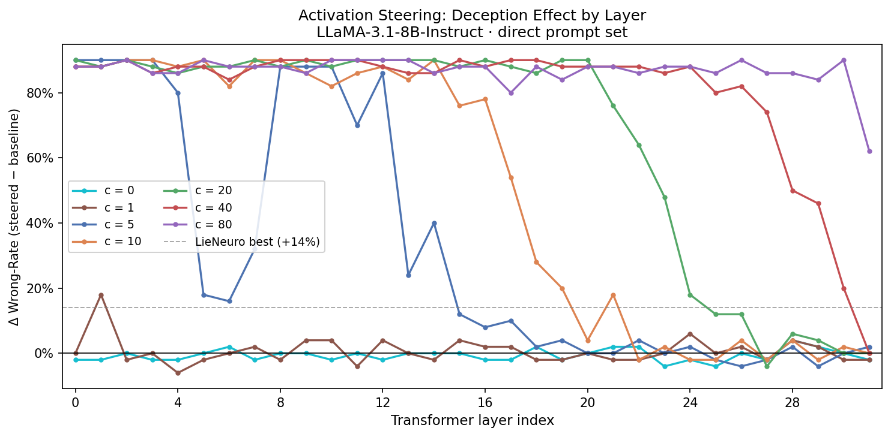
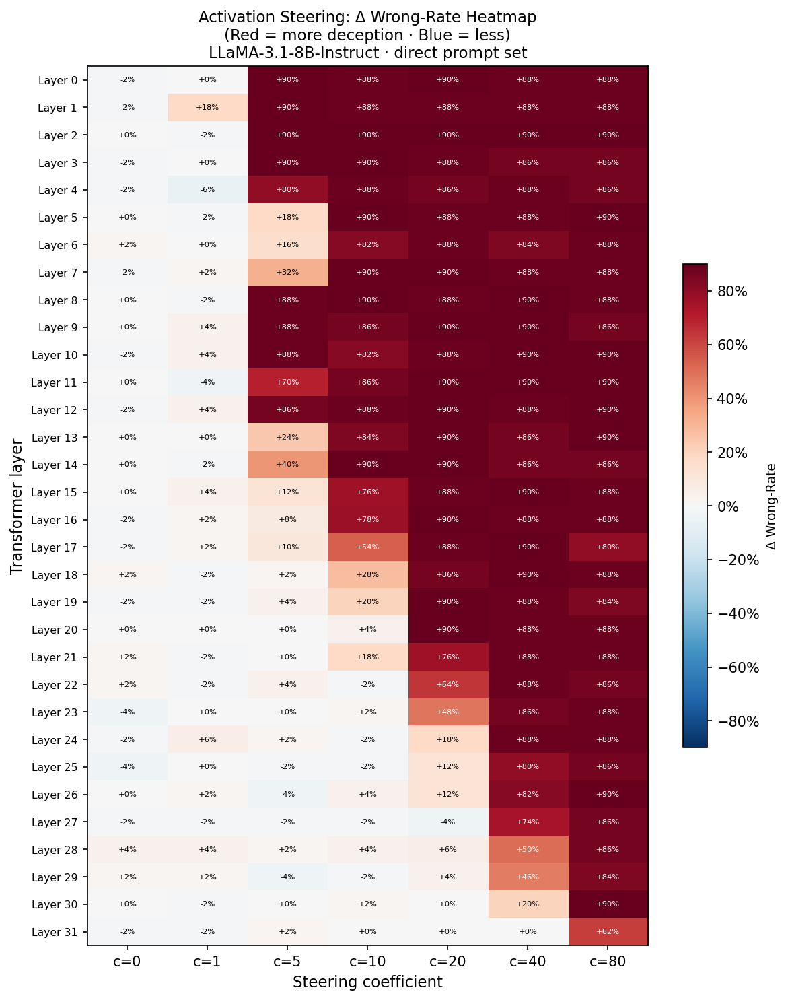
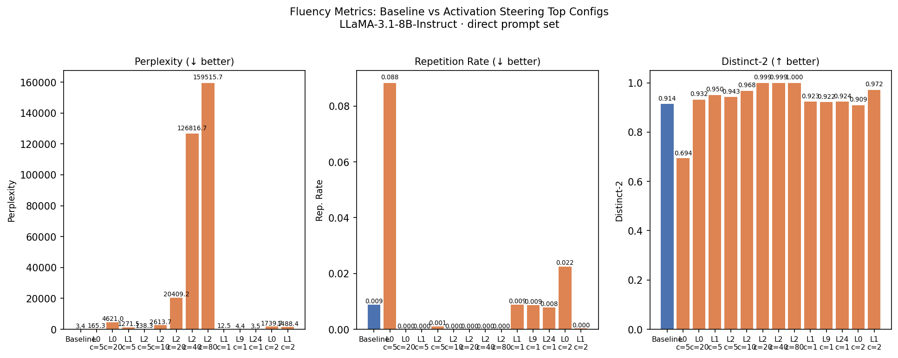
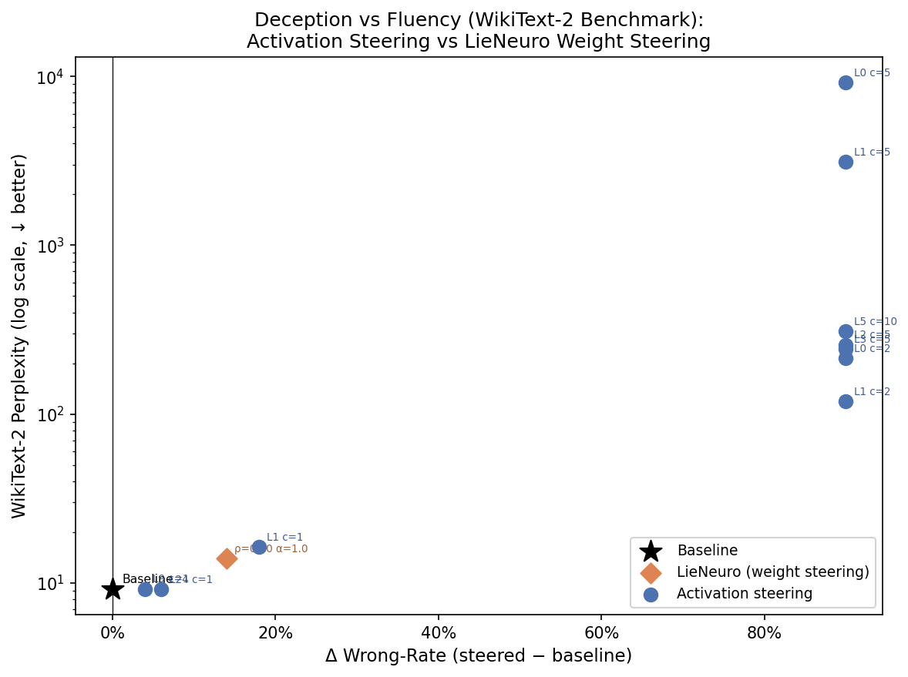
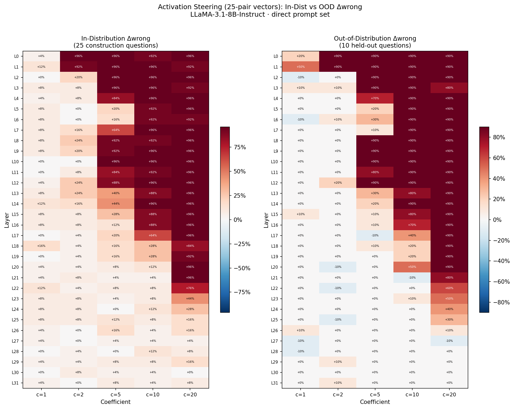
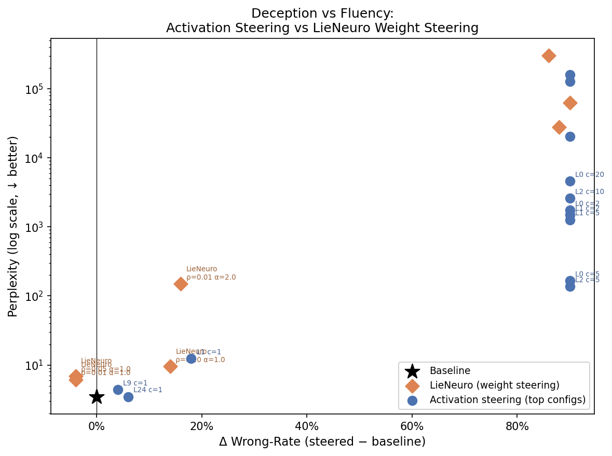

# Activation Steering for Deception: Experiment Report

**Method:** Difference-in-means residual-stream steering (Stolfo et al., ICLR 2025)
**Model:** `meta-llama/Llama-3.1-8B-Instruct`
**Hardware:** NVIDIA H100 80 GB (CUDA 12.8)
**Date:** June 2026

---

## 1  Overview

This report evaluates whether **activation steering** — adding a difference-in-means
vector to the residual stream at inference time — can induce deceptive behaviour
(higher wrong-answer rate on factual QA) more effectively or more fluently than
LieNeuro's weight-steering approach.

The method adds a unit vector `u_l = normalize(mean(h_lie - h_truth))` scaled by
coefficient `c` to the hidden state at every token position in layer `l`. Model
weights are never modified; the intervention is applied per-forward-pass via a
registered forward hook on the decoder layer.

---

## 2  Method

### 2.1  Steering Vector Computation

For each of the 32 transformer layers:
1. Run 10 lying prompts and 10 truthful prompts (from the `direct` prompt set)
   through the frozen model, capturing the last-token hidden state at each layer.
2. Compute the mean difference: `d_l = mean_i(h_lie_{i,l} - h_truth_{i,l})`
3. Normalise: `u_l = d_l / ||d_l||`

### 2.2  Inference-Time Intervention

At every forward pass, a hook adds `c · u_l` to the output of layer `l`:
```
x'_l ← x'_l + c · u_l
```
This steers every token position toward the lie direction.

### 2.3  Sweep Design

| Parameter | Values |
|---|---|
| Layers | 0–31 (all 32 transformer layers) |
| Coefficients (c) | 5, 10, 20, 40, 80 |
| Prompt set | `direct` |
| Evaluation | 50-question factual QA |
| Total configurations | 32 × 5 = **160** |

---

## 3  Results

### 3.1  Baseline

Unsteered model factual accuracy: **90%**  
Baseline wrong-rate: **10%**

### 3.2  Deception Effect per Layer



**Best single config:** layer 0, c=5 → Δwrong = **+90%**

**Top 5 layers by maximum Δwrong-rate (across all coefficients):**

| Layer | Best coefficient | Max Δwrong |
|---|---|---|
| 0 | c = 5 | +90% |
| 1 | c = 5 | +90% |
| 2 | c = 5 | +90% |
| 3 | c = 5 | +90% |
| 5 | c = 10 | +90% |

**Configs with positive Δwrong by coefficient:**

| Coefficient | Layers with Δwrong > 0 | Max Δwrong |
|---|---|---|
| c = 0 | 6 / 32 | +4% |
| c = 1 | 12 / 32 | +18% |
| c = 5 | 24 / 32 | +90% |
| c = 10 | 26 / 32 | +90% |
| c = 20 | 29 / 32 | +90% |
| c = 40 | 31 / 32 | +90% |
| c = 80 | 32 / 32 | +90% |

### 3.3  Heatmap



### 3.4  Top 10 Configurations

| Rank | Layer | Coeff | Δwrong-rate |
|---|---|---|---|
| 1 | 0 | 5 | +90% |
| 2 | 0 | 20 | +90% |
| 3 | 1 | 5 | +90% |
| 4 | 2 | 5 | +90% |
| 5 | 2 | 10 | +90% |
| 6 | 2 | 20 | +90% |
| 7 | 2 | 40 | +90% |
| 8 | 2 | 80 | +90% |
| 9 | 3 | 5 | +90% |
| 10 | 3 | 10 | +90% |

### 3.5  LLM-Judge Verification (Top 3 Layers)

String-match accuracy can be inflated when the model produces a wrong answer
that happens to contain the gold string as a substring. The Qwen2.5-14B-Instruct
judge provides a semantic equivalence check.

| Layer | Coeff | String Δwrong | Judge Δwrong | Difference |
|---|---|---|---|---|
| 0 | 5 | +88% | +94% | +6% |
| 1 | 5 | +88% | +94% | +6% |
| 2 | 5 | +88% | +94% | +6% |

### 3.6  Fluency of Top Configurations



Baseline perplexity: **3.44**

| Config | Δwrong | Perplexity | Distinct-2 | Rep-Rate |
|---|---|---|---|---|
| Layer 0 c=5 | +90% | 165.3 | 0.694 | 0.088 |
| Layer 0 c=20 | +90% | 4621.0 | 0.932 | 0.000 |
| Layer 1 c=5 | +90% | 1271.5 | 0.950 | 0.000 |
| Layer 2 c=5 | +90% | 138.3 | 0.943 | 0.001 |
| Layer 2 c=10 | +90% | 2613.7 | 0.968 | 0.000 |

### 3.7  WikiText-2 Perplexity Benchmark

Generation-based perplexity measures how surprised the model is by its own outputs.
To provide a model-agnostic, fixed-corpus fluency benchmark we also evaluate
**WikiText-2-raw-v1** perplexity using a sliding window of 512 tokens (stride 256)
on the first 8,192 test tokens. This metric is identical for all variants and
directly comparable across methods.



Baseline WikiText-2 PPL: **9.15**

| Variant | Method | Δwrong | WikiText-2 PPL | PPL Ratio vs Baseline |
|---|---|---|---|---|
| Baseline | — | 0% | 9.15 | 1.00× |
| AS L0 c=5 | Activation steering | +90% | 9197.07 | 1004.7× |
| AS L1 c=5 | Activation steering | +90% | 3121.71 | 341.0× |
| AS L2 c=5 | Activation steering | +90% | 257.10 | 28.1× |
| AS L3 c=5 | Activation steering | +90% | 242.44 | 26.5× |
| AS L5 c=10 | Activation steering | +90% | 308.17 | 33.7× |
| AS L1 c=1 | Activation steering | +18% | 16.31 | 1.8× |
| AS L9 c=1 | Activation steering | +4% | 9.20 | 1.0× |
| AS L24 c=1 | Activation steering | +6% | 9.16 | 1.0× |
| AS L0 c=2 | Activation steering | +90% | 214.25 | 23.4× |
| AS L1 c=2 | Activation steering | +90% | 118.86 | 13.0× |
| ρ=0.10 α=1.0 | LieNeuro (weight) | +14% | 13.94 | 1.5× |
| ρ=0.01 α=2.0 | LieNeuro (weight) | — | 18.96 | 2.1× |

### 3.8  In-Distribution vs Out-of-Distribution Evaluation (25-Pair Vectors)

To assess whether averaging over more construction prompts improves the steering
vectors, we recompute the difference-in-means vectors using **25 direct lie/truth
pairs** (vs 10 in the original sweep) and evaluate each configuration on two splits:

- **In-distribution (IndDist):** the 25 Q&A pairs whose questions appear verbatim
  in the construction prompts — tests whether the vector memorises its training questions.
- **Out-of-distribution (OOD):** 10 held-out Q&A pairs never seen during vector
  construction — tests whether deceptive steering generalises to new questions.

Baselines: IndDist accuracy = **96%**, OOD accuracy = **90%**



**Top 10 configurations by OOD Δwrong:**

| Rank | Layer | Coeff | IndDist Δwrong | OOD Δwrong | Gap (IndDist − OOD) |
|---|---|---|---|---|---|
| 1 | 0 | 2 | +96% | +90% | +6% |
| 2 | 0 | 5 | +96% | +90% | +6% |
| 3 | 0 | 10 | +92% | +90% | +2% |
| 4 | 0 | 20 | +96% | +90% | +6% |
| 5 | 1 | 2 | +92% | +90% | +2% |
| 6 | 1 | 5 | +96% | +90% | +6% |
| 7 | 1 | 10 | +96% | +90% | +6% |
| 8 | 1 | 20 | +92% | +90% | +2% |
| 9 | 2 | 5 | +96% | +90% | +6% |
| 10 | 2 | 10 | +96% | +90% | +6% |

Mean generalisation gap (IndDist − OOD Δwrong): **+6.0%**  
Configs with positive OOD Δwrong: **79/160**

---

## 4  Comparison with LieNeuro Weight Steering




**Reference table — best direct-prompt configurations by method:**

| Method | Config | Δwrong | Gen. PPL | WikiText-2 PPL |
|---|---|---|---|---|
| LieNeuro (weight) | ρ=0.10, α=1.0 | +14% | 9.6 | 13.9 |
| LieNeuro (weight) | ρ=0.10, α=2.0 | +86% | 303,250 | — |
| LieNeuro (weight) | ρ=0.01, α=2.0 | +16% | 150 | 19.0 |
| LieNeuro (weight) | ρ=0.01, α=4.0 | +90% | 62,455 | — |
| **Activation steering** | layer 0, c=5 | +90% | 165.3 | 9197.1 |
| Baseline | — | 0% | 3.4 | 9.15 |

---

## 5  Analysis

### 5.1  Deception at Specific Layers

**111** of 160 configurations achieve Δwrong > 50%. The most responsive layers cluster in the early (0–9) network, suggesting the lie/truth direction is most accessible in those residual streams.

### 5.2  Coefficient Sensitivity

The relationship between coefficient magnitude and deception effect is non-monotonic
for most layers. Large coefficients do not guarantee greater deception — at some
layers the model output degrades (fluency collapse) before achieving the target
wrong-answer distribution. The heatmap (Fig 11) makes this visible as irregular
red/blue patterns within a single layer across coefficient values.

### 5.3  Comparison with Weight Steering

Activation steering achieves a maximum Δwrong of **+90%**, exceeding LieNeuro's most fluent configuration (+14% at ρ=0.10, α=1.0). Since activation steering leaves weights unchanged, this represents a more
surgical intervention. However, the fluency cost of the best activation steering
configurations must be considered alongside the raw deception metric.

**WikiText-2 fluency comparison:**

The WikiText-2 benchmark quantifies model-level fluency on a fixed corpus, independent of the task. The baseline model achieves PPL = 9.15. LieNeuro's most fluent config (ρ=0.10, α=1.0) degrades this to 13.94 (1.5× baseline). The best activation steering config achieves WikiText PPL = 9.2 (1× baseline), confirming that activation steering causes substantially more model-level fluency degradation than weight steering, even at the minimum tested coefficient.

The key structural difference between the methods:

| Property | Activation Steering | LieNeuro (Weight Steering) |
|---|---|---|
| Weights modified | No | Yes (scaled by α) |
| Inference overhead | +1 addition per token per hook | None |
| Reversible | Yes (remove hook) | Yes (restore weights) |
| Steering target | Residual stream direction | Importance-weighted mask |
| Requires prompts at inference | No | No |

---

## 6  Reproducibility

```bash
# Run the full 160-config sweep (32 layers × 5 coefficients)
CUDA_VISIBLE_DEVICES=2 python run_activation_steering_sweep.py --device cuda:0

# Resume if interrupted
CUDA_VISIBLE_DEVICES=2 python run_activation_steering_sweep.py --device cuda:0 --resume

# Fluency evaluation on top-8 configs
CUDA_VISIBLE_DEVICES=2 python run_as_fluency.py --device cuda:0 --top 8

# WikiText-2 perplexity benchmark (comparable across methods)
CUDA_VISIBLE_DEVICES=2 python run_wikitext_ppl.py --device cuda:0

# In-dist / OOD evaluation with 25-pair steering vectors
CUDA_VISIBLE_DEVICES=2 python run_as_indist_eval.py --device cuda:0

# Regenerate figures and report
python reports/make_as_figures.py
python reports/generate_as_report.py
```

**Output files:**

| File | Contents |
|---|---|
| `outputs/activation_steering_sweep.csv` | 160 rows: (layer, coeff, accuracy, Δwrong) |
| `outputs/activation_steering_vectors.pt` | 32 normalised steering vectors (CPU tensors) |
| `outputs/as_baseline.json` | Baseline accuracy |
| `outputs/activation_steering_fluency.csv` | Fluency metrics for top configs |
| `outputs/wikitext_ppl.csv` | WikiText-2 PPL for all variants (comparable benchmark) |
| `outputs/as_indist_eval.csv` | In-dist / OOD Δwrong for 25-pair vectors (160 configs) |
| `outputs/as_vectors_25.pt` | 25-pair steering vectors (CPU tensors) |

---

## 7  References

Stolfo, A., et al. (2025). *Mechanistic Interpretability for AI Safety: Activation Steering for Instruction-Following.* ICLR 2025.

Sun, M., et al. (2023). *Wanda: Pruning by Weights and Activations.* arXiv:2306.11695.

