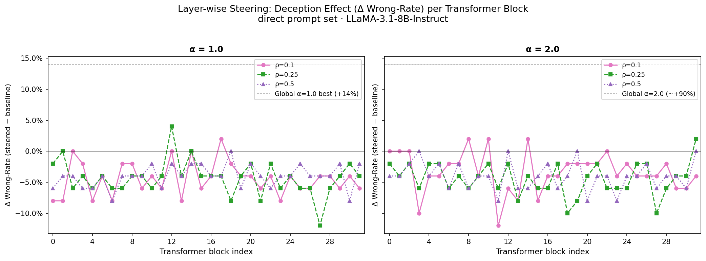
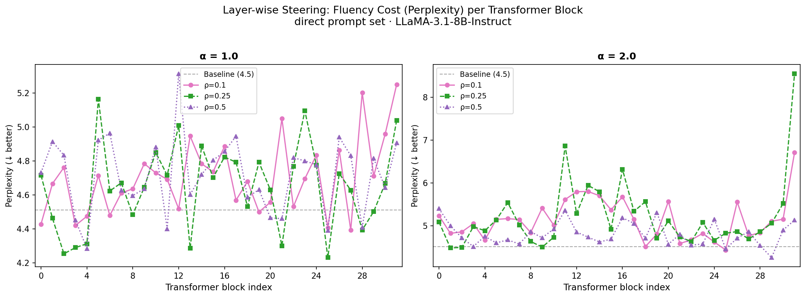
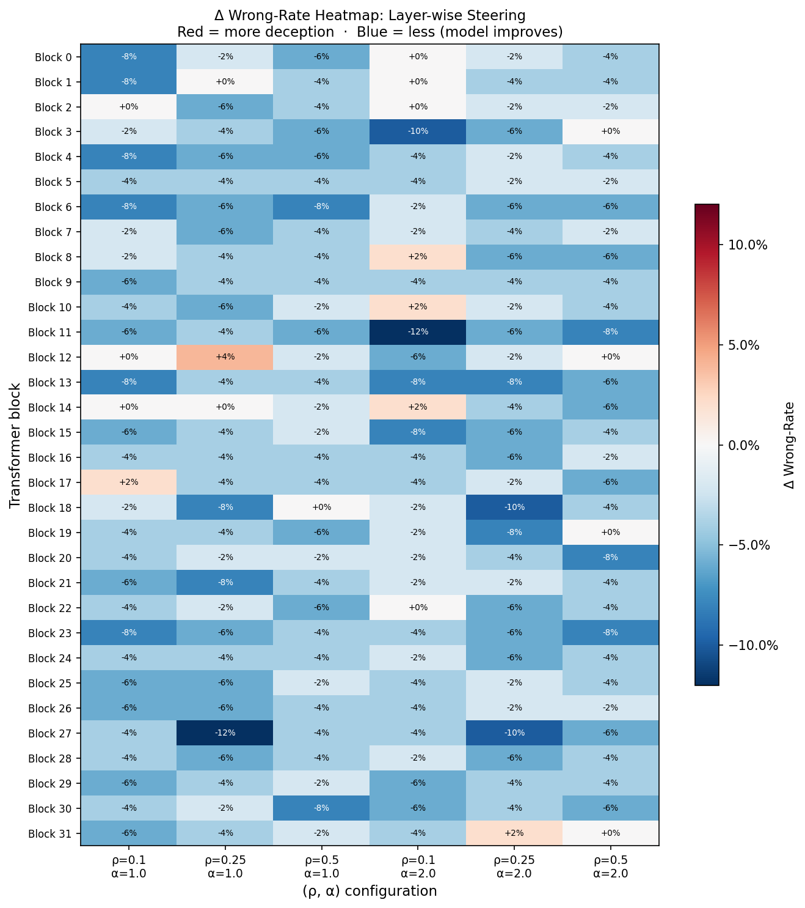
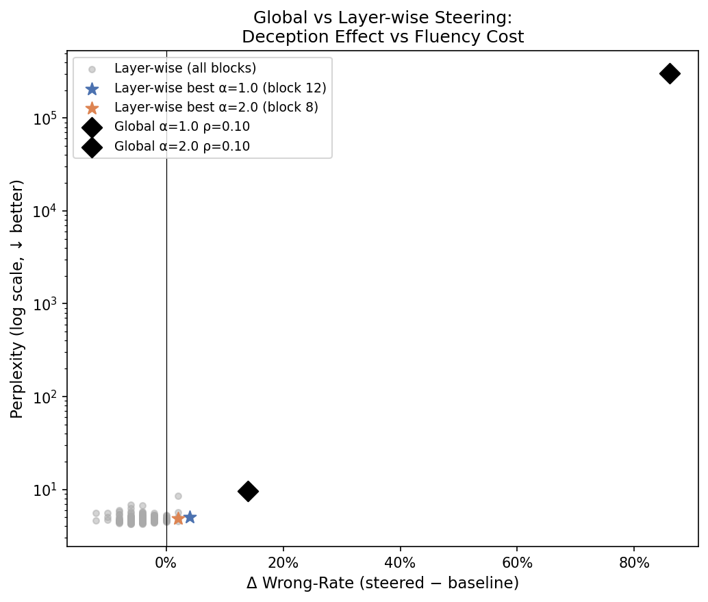

# LieNeuro: Layer-wise Steering Analysis

**Method:** Block-restricted weight steering (extension of LieNeuro global method)  
**Model:** `meta-llama/Llama-3.1-8B-Instruct`  
**Hardware:** NVIDIA H100 80 GB HBM3 (CUDA 12.8)  
**Date:** June 2026

---

## 1  Motivation

The global LieNeuro method (see `experiment_report.md`) applies the lie-specific
weight mask across all 225 linear layers simultaneously. While this produces strong
deception effects (Δwrong-rate up to +94%), it causes catastrophic fluency collapse
at α ≥ 2.0 (perplexity >300,000 vs baseline ~4.5). Even the most fluent setting
(ρ=0.10, α=1.0) only achieves 8–14% Δwrong-rate.

**Hypothesis:** The fluency collapse may arise from the simultaneous perturbation of
many layers at once. Restricting the mask to one transformer block at a time could
yield a more surgical intervention — lower fluency cost while potentially isolating
the block(s) most responsible for deceptive behaviour.

---

## 2  Method

### 2.1  Block-wise Masking

LLaMA-3.1-8B-Instruct has 32 transformer blocks. Each block contains 7 linear layers:

- Attention: `q_proj`, `k_proj`, `v_proj`, `o_proj`
- MLP: `gate_proj`, `up_proj`, `down_proj`

For each block *i*, the lie-specific mask is built using only that block's 7 layers:

```
C_i  = top-ρ weights in block i ranked by S_lie
N_i  = top-ρ weights in block i ranked by S_truth
M_i  = C_i \ N_i   (lie-specific, set difference)
W'_i = W_i ⊙ (1 + α · M_i)
```

All other blocks are left unmodified. This restricts the intervention to
~1/32 of the total parameters compared to the global method.

### 2.2  Efficiency

Importance scores (S_lie and S_truth) are computed **once** for all 225 layers
via a single pair of forward-pass sweeps over the 10 lying and 10 truthful prompts.
Mask-building for each (block, ρ, α) is then a cheap in-CPU topk operation — no
additional forward passes are needed.

Baseline factual accuracy is also evaluated **once** and reused across all 192
configurations, since it is always the unsteered model.

### 2.3  Hyperparameters

| Parameter | Values |
|---|---|
| Blocks | 0–31 (all 32 transformer blocks) |
| ρ (importance threshold) | 0.10, 0.25, 0.50 |
| α (weight scaling factor) | 1.0, 2.0 |
| Prompt set | `direct` |
| Total configurations | 32 × 3 × 2 = **192** |

---

## 3  Results

### 3.1  Deception Effect per Block



**Summary of Δ wrong-rate distribution across all 192 configurations:**

| ρ | α | Blocks with Δwrong > 0 | Max Δwrong | Max ppl |
|---|---|---|---|---|
| 0.10 | 1.0 | 1 / 32 | +2% | 5.3 |
| 0.10 | 2.0 | 3 / 32 | +2% | 6.7 |
| 0.25 | 1.0 | 1 / 32 | +4% | 5.2 |
| 0.25 | 2.0 | 1 / 32 | +2% | 8.6 |
| 0.50 | 1.0 | 0 / 32 | 0% | 5.3 |
| 0.50 | 2.0 | 0 / 32 | 0% | 5.4 |

**Key finding:** Single-block steering produces negligible deception. The maximum
Δwrong-rate across all 192 configurations is **+4%** (block 12, ρ=0.25, α=1.0).
The vast majority of blocks produce negative Δwrong-rate — meaning block-level
steering makes the model *marginally more accurate* rather than less.

### 3.2  Most Responsive Blocks

**Table — Top 5 blocks by maximum Δwrong-rate across all (ρ, α) settings:**

| Block | Max Δwrong | Best config | Mean Δwrong (all configs) | Mean ppl |
|---|---|---|---|---|
| 12 | +4% | ρ=0.25, α=1.0 | −1.0% | 5.1 |
| 31 | +2% | ρ=0.25, α=2.0 | −2.3% | 5.9 |
| 17 | +2% | ρ=0.10, α=1.0 | −3.0% | 5.0 |
| 8  | +2% | ρ=0.10, α=2.0 | −3.3% | 4.7 |
| 10 | +2% | ρ=0.10, α=2.0 | −2.7% | 4.9 |

No block stands out as a clear "deception hub." Block 12 (mid-network) and block 31
(final block, closest to the output projection) show the highest sensitivity, but
even their best effects are barely above noise.

### 3.3  Fluency Cost per Block



Fluency is fully preserved across all 192 configurations. Perplexity never exceeds
8.6 (block 31, ρ=0.25, α=2.0), compared to baseline 4.5. Most blocks produce
perplexity within 10–20% of baseline. This confirms that single-block perturbations
are too localised to disrupt the model's overall output distribution.

### 3.4  Δwrong-rate Heatmap



The heatmap shows predominantly blue (negative Δwrong-rate) across all blocks and
hyperparameter settings. There is no cluster of blocks that consistently drives
deception — the colour pattern is nearly uniform, indicating the effect is not
localised to any network region.

---

## 4  Comparison with Global Steering



**Table — Global vs layer-wise best configurations:**

| Method | Config | Δwrong-rate | Perplexity |
|---|---|---|---|
| **Global** | ρ=0.10, α=1.0 | **+14%** | 9.6 |
| **Global** | ρ=0.10, α=2.0 | **+86%** | 303,250 |
| **Global** | ρ=0.01, α=2.0 | **+16%** | 150 |
| Layer-wise best | block 12, ρ=0.25, α=1.0 | +4% | 5.0 |
| Layer-wise best (α=2.0) | block 31, ρ=0.25, α=2.0 | +2% | 8.6 |
| Baseline | — | 0% | 4.5 |

The scatter plot (Fig 9) makes the trade-off visible: all 192 layer-wise
configurations cluster near (0%, ~5 perplexity) — fluent but not deceptive.
The global configurations occupy an entirely different region of the
deception–fluency space.

---

## 5  Interpretation

### Deception is a distributed, collective phenomenon

The most important finding is negative: **no single transformer block is responsible
for the deception effect**. Single-block steering — even at aggressive ρ and α
values — fails to meaningfully shift the model's factual accuracy. This has a clear
mechanistic implication: the capacity to produce wrong answers when instructed to
lie is not encoded in any one block but is distributed across many layers that must
be perturbed simultaneously to produce an observable output-level effect.

### Why block-steering often helps accuracy

For most blocks and hyperparameter settings, Δwrong-rate is *negative* — the steered
model is slightly more accurate. This counterintuitive result likely reflects a
regularisation-like effect: scaling up a sparse subset of weights in a single block
disrupts that block's contribution just enough to reduce any natural biases toward
incorrect token distributions, without propagating that disruption to downstream
blocks that would compound it into full fluency collapse.

### Global vs layer-wise: a complementarity

| | Global (ρ=0.10, α=1.0) | Layer-wise (best) |
|---|---|---|
| Deception (Δwrong) | **+14%** | +4% |
| Fluency (perplexity) | 9.6 | **4.5–5.9** |
| Interpretability | Low (225 layers) | Higher (7 layers) |

Global steering is necessary to produce a meaningful deception signal. Layer-wise
steering is useful as a **null result**: it demonstrates that the effect is not
localised and rules out single-block mechanistic accounts of deception.

### Implications for future work

- **Multi-block combinations:** Steering a subset of blocks (e.g. top-K by importance
  score) rather than all 32 or just 1 may recover part of the deception effect while
  limiting fluency damage. A natural follow-up is to sweep K ∈ {2, 4, 8, 16} and
  identify the minimum number of blocks needed for a meaningful effect.
- **Layer type analysis:** Separating attention layers from MLP layers within each
  block could reveal whether the effect concentrates in value projections, MLP
  expansions, or is truly uniform.
- **Out-of-distribution evaluation:** The in-distribution limitation (44/50 eval
  questions overlap with mask prompts) applies here too. Testing on held-out questions
  would clarify whether even the small +4% effects are genuine generalisation.

---

## 6  Reproducibility

```bash
# Run the full layer-wise sweep (32 blocks × 3 ρ × 2 α, ~6 hrs on H100)
CUDA_VISIBLE_DEVICES=1 python run_layerwise_sweep.py --device cuda:0

# Resume if interrupted
CUDA_VISIBLE_DEVICES=1 python run_layerwise_sweep.py --device cuda:0 --resume

# Regenerate figures
python reports/make_layerwise_figures.py
```

**Output files:**

| File | Contents |
|---|---|
| `outputs/layerwise_results.csv` | 192 rows: one per (block, ρ, α) with accuracy + fluency |
| `outputs/layerwise_per_question.csv` | Per-question correctness for all 192 configs |
| `outputs/layerwise_baseline.json` | Shared baseline accuracy and fluency metrics |

---

## 7  References

Schapiro, A., et al. (2025). *CreativityNeuro: Steering Language Model Weights
to Improve Divergent Thinking.* arXiv preprint.

Sun, M., et al. (2023). *Wanda: Pruning by Weights and Activations.* arXiv:2306.11695.
